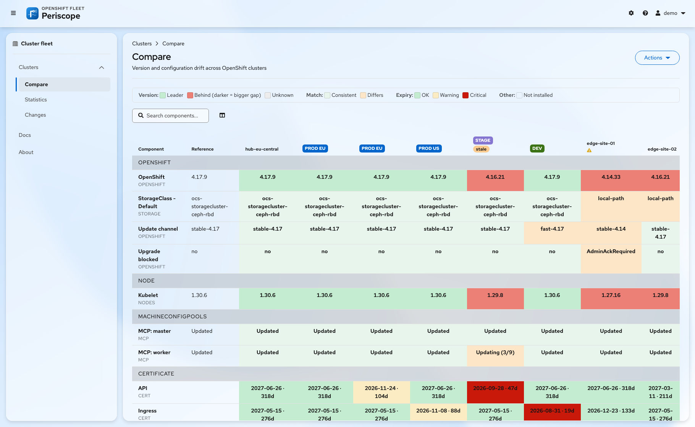

# Pages

| Page | Answers | Notes |
|---|---|---|
| **Compare** | Do my clusters agree on versions and settings? | Version rows, coloured by [drift](../architecture/drift-model.md) |
| **Statistics**, table | What is the count on each cluster? | Nodes, pods, PVCs and PVs, VMs |
| **Statistics**, charts | Which clusters carry the fleet? | One bar chart per row, and a fleet total. Rows that are not counts are listed as skipped. |
| **Statistics**, timeline | When did a count move? | One line per cluster over 1, 2, 5, 7, 14 or 30 days |
| **Changes** | What changed, and when? | An audit feed and a calendar. **View the matrix as it was** loads any past day. |
| **Docs, Clusters** | How do I join, remove or purge a cluster? | The **Add a cluster** wizard and the remove and purge commands for this hub |
| **Docs, Components** | Which keys exist? | The component keys of this fleet, with a filter by text and group |
| **Docs, MCP** | How do I connect an AI assistant? | The MCP URL of this hub, the token button, client config and the tools |
| **Docs, API** | How do I script against the hub? | The REST endpoints, access rules and `curl` examples for this hub |
| **About** | Which build runs? | The version string |



# The column header

* The title is the cluster name, or the text of its `cluster-name`
  ConsoleNotification.
* A click opens the web console of that cluster in a new tab.
* A `stale since HH:MM` badge and an error icon show a failed scrape and its
  reason.

# Toolbar and masthead

| Control | Effect |
|---|---|
| Search | Filters rows by name, on the client |
| **Manage view** | Hides clusters for this browser only. Hidden clusters still count in the baseline, the exports and the metrics. |
| **Refresh** | Starts a scrape now |
| **Export CSV** / **Export JSON** | Downloads the page on screen, with its rows and visible clusters |
| **Actions**, **Purge stale data** | Deletes the history of removed clusters. Admins only. See [Remove a cluster](../operations/remove-cluster.md). |
| Settings menu | Colour scheme, theme and contrast, per browser |

# History mode

**View the matrix as it was** on the Changes page loads the matrix of a past
moment, with exports. A banner shows that you look at history until you leave it.

# Try the UI with no cluster

```bash
make web-mock
```

This serves the UI with a synthetic fleet of eight clusters, with drift,
expiring certificates, one stale cluster and a month of history. No cluster,
no Go server and no database are needed.
